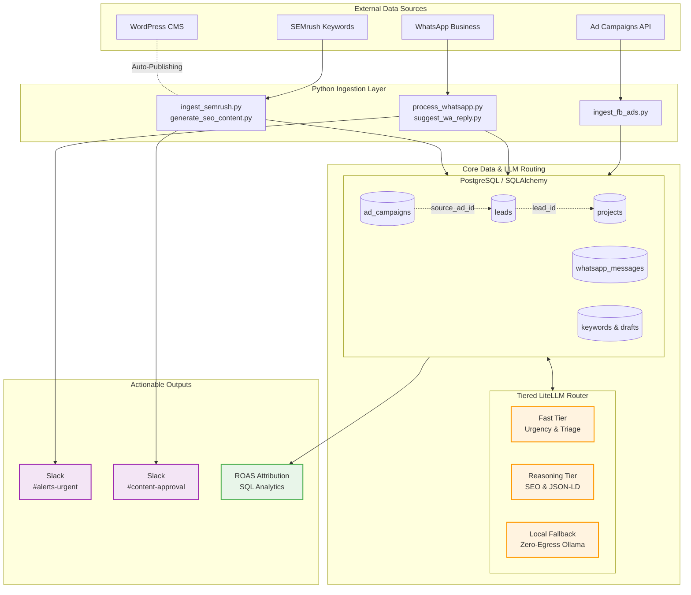

# AI Revenue Attribution & Lead Analytics Engine

[](https://github.com/SerjCallier/ai-system-builder-showcase/actions)


**English** | [Español](README.es.md)

Sanitized architectural proof of concept for a **centralized AI orchestration & revenue attribution engine** unifying ad spend, messaging triage, SEO content pipelines, and signed contract values inside a single relational PostgreSQL schema via SQLAlchemy and LiteLLM.

---

## Executive Summary

Instead of measuring vanity form leads, this system closes the attribution loop between marketing acquisition, customer messaging, and real closed revenue:

1. **Multi-Touch Revenue Attribution:** Relational joins (`ad_campaigns -> leads -> projects`) compute true ROAS against closed-won contracts.
2. **Urgency Triage & Reply Drafting:** Classifies incoming WhatsApp operational messages and dispatches structured Slack Block Kit alerts.
3. **Tiered Multi-Model Routing:** Uses `litellm` to route low-latency triage, deep SEO JSON-LD drafting, and local offline fallbacks behind a unified interface.

---

## System Architecture



---

## Verification & Local Run

```bash
git clone https://github.com/SerjCallier/ai-system-builder-showcase.git
cd ai-system-builder-showcase

python -m venv .venv
source .venv/bin/activate  # Windows: .venv\Scripts\activate
pip install -r requirements.txt

# Run offline SQLAlchemy schema & ROAS attribution unit tests (SQLite in-memory)
python -m unittest discover -s tests -v

# Syntax-check all modules
python -m compileall -q config.py main.py core scripts tests
```

---

## Project Structure

```text
ai-system-builder-showcase/
├── .github/workflows/ci.yml      # GitHub Actions syntax + schema ROAS tests
├── config.py                     # Sanitized env configuration & mock defaults
├── main.py                       # End-to-end simulation entrypoint
├── core/
│   ├── db.py                     # SQLAlchemy ORM models (Campaigns, Leads, Projects)
│   └── slack.py                  # Slack Block Kit alert builders
├── scripts/
│   ├── ingest_fb_ads.py          # Ad spend ingestion & ROI evaluator
│   ├── process_whatsapp.py       # Urgency classifier
│   ├── suggest_wa_reply.py       # Drafted response generator
│   ├── ingest_semrush.py         # Keyword pipeline
│   └── generate_seo_content.py   # Structured JSON-LD content generator
└── tests/
    └── test_smoke.py             # Offline ROAS join & sanitized config tests
```

---

## License

MIT © [Sergio Callier](https://github.com/SerjCallier)
